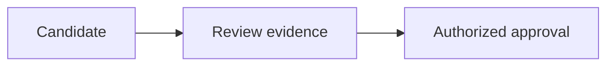

# Portable Markdown design

This is original Nix-authored guidance, not copied or renamed upstream skill text. Core content must remain understandable in GitHub, ordinary Markdown, and Obsidian with community plugins and Bases disabled.

## Information architecture

Use one descriptive H1, a short answer-first opening, then ordered heading levels. State provisional, disputed, or superseded status visibly. Never rely on a colored badge, hidden comment, CSS class, collapsed panel, or frontmatter alone to communicate authority.

| Family | Suggested reading order |
| --- | --- |
| Decision | Decision, context, alternatives, evidence, consequences, revisit conditions |
| Playbook | Outcome, authority/preconditions, numbered steps, verification, failure/rollback |
| Reference | Scope, quick answer, details/examples, limits, sources |
| Strategy | Thesis, goals/non-goals, choices, assumptions/evidence, review triggers |
| Technical explanation | Mental model, components/flow, example, boundaries, project links |
| Investigation/research | Question, cited findings, method, competing evidence, recommendation |

Use tables for comparisons, not paragraphs with borders. Keep columns few and labels short; use sections/lists for long evidence. Do not impose fixed-width layouts or decorative hard wrapping. A map of content should guide a real reading path rather than inventory every file.

## Portable patterns

Prefer `[Lifecycle](../../_meta/lifecycle.md)` within the actual KB when that relative path resolves; do not copy this illustrative path without checking its location. Across repositories use canonical HTTPS file URLs; evidence requiring immutability uses a full commit. Prefer simple unique heading anchors and verify exact case, encoding, and targets in both readers. Wikilinks, block IDs, and transclusions must not carry the only copy of essential meaning.

An ordinary blockquote retains this warning even without callout styling:

```markdown
> [!WARNING]
> This observation is provisional. Confirm its evidence before using it for a decision.
```

Use descriptive alt text for essential images, keep assets local and licensed, and explain the conclusion inline. Avoid remote tracking images, HTML layouts, hidden `%%comments%%`, inline Obsidian footnotes, custom CSS, and plugin queries as core semantics.

## Diagrams with text equivalents

Use a conservative Mermaid subset with quoted labels, no click callbacks, remote includes, JavaScript, or HTML-dependent styling. Example authoring pattern (not a claim of renderer testing):

````markdown


A candidate goes to evidence review, then authorized approval. Rejected or disputed evidence remains non-current; this diagram does not automate promotion.
````

Check diagram syntax with the repository's pinned validator where provided; a Markdown or YAML pass does not validate Mermaid. Preserve adjacent prose even when renderers support `accTitle` and `accDescr`. Test actual viewer versions before claiming rendered acceptance.

## Properties and validation

Load repository `AGENTS.md` and `_meta/conventions.md` first. Use its required `type`, `validity`, `owner`, quoted ISO `created`/`updated`, and `sources`; use optional `review-by`, `supersedes`, `superseded-by`, and `related` only as defined there. Empty sources are only for explicitly provisional/unsourced content. Reject duplicate YAML keys, custom tags, and resource-amplifying aliases. A complete schema is not evidence of truth approval.

Verify one H1, heading order, purposeful tables, balanced/language-labeled code fences (including nested examples), real link targets and anchors, asset alt text, valid frontmatter, supersession/evidence, and no forbidden sensitive/runtime files. Use the KB's actual validator rather than claiming a single regex parses Markdown. Keep external-link checks bounded and separate; private 401/403 is not automatically a broken link, and private content must not go to public lint services.

For visual acceptance inspect representative decision, playbook, and research notes in default-theme Obsidian reading view and GitHub, light/dark and narrow viewport. Disable community plugins and Bases; verify callout fallback, long tables, diagrams, links, and visible caveats. Record versions/screenshots. These checks are future acceptance gates, not tests already performed by this candidate.

## Optional Bases

Bases is an optional Obsidian core-plugin view over canonical Markdown properties, not a second store. A note remains useful without its `.base` view. Use explicit authorized vault scope; avoid remote `image()`, HTML formulas, and Map/community-plugin dependencies. Filters are not privacy ACLs, and editing properties in a Base can mutate Markdown. Use canonical dates, not clone-dependent filesystem timestamps. No Dataview, Templater, Knap, Sync, custom CSS, or Obsidian CLI is required.

## Upstream assessment and reuse boundary

Reviewed upstream: [kepano/obsidian-skills at 3ccff5338ea700537839b21900aa5358a0402c98](https://github.com/kepano/obsidian-skills/tree/3ccff5338ea700537839b21900aa5358a0402c98). The assessed `obsidian-markdown` and `obsidian-bases` instruction closures contain six documentation files, no packaged executables. Static Agent Skills format compatibility is not an installed Hermes safety or rendering test. Upstream commit signature was not independently verified because its signing key was unavailable.

[The pinned MIT license](https://github.com/kepano/obsidian-skills/blob/3ccff5338ea700537839b21900aa5358a0402c98/LICENSE) permits adaptation/commercial reuse with notice preservation: `Copyright (c) 2026 Steph Ango (@kepano)`. If substantial upstream text is later copied, include the complete copyright, permission, and warranty notice inside the distributed payload, plus per-file provenance and a new immutable digest. A source link alone is not that notice. No substantial upstream text is included here.

Upstream Markdown is syntax guidance, not Nix editorial/provenance policy. Upstream Bases requires compatible app behavior and does not enforce access. Adjacent CLI/fetch/generation skills expand execution and overwrite authority and are excluded. Mutable help links are untrusted references, never authority overrides. `obsidian-markdown` and `qmd` remain governed task-only; no new upstream installation is requested here.
